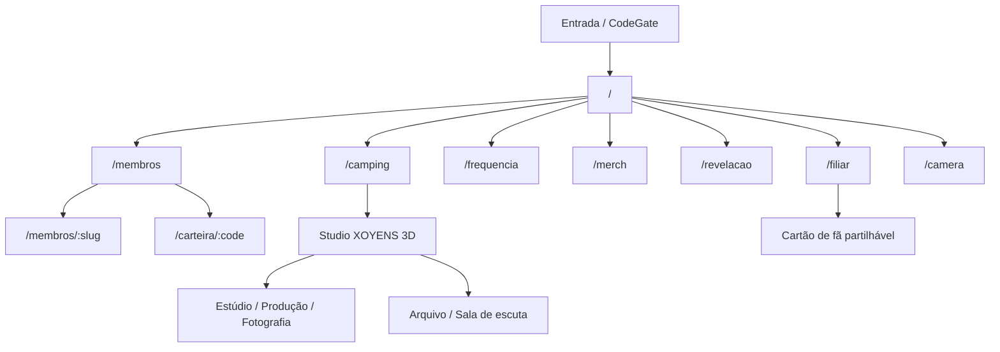
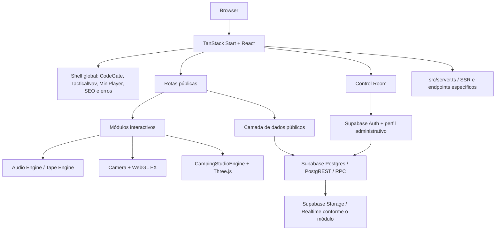
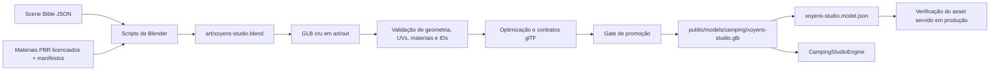

# O Sindicato do Trap

**Syndicate Drop Zone** é o hub digital do movimento **O Sindicato do Trap**. O projecto combina um portal editorial para artistas, música e conteúdos exclusivos com uma rádio própria, ferramentas de filiação, reservas de merchandising, uma câmara criativa e uma experiência 3D imersiva do Studio XOYENS.

A plataforma foi desenhada como uma experiência underground, com linguagem visual de arquivo confidencial, bunker, fita analógica e sinal 808. A aplicação não é apenas uma landing page: contém rotas públicas, módulos de experiência interactiva, lógica de áudio partilhada, integração com Supabase, uma área administrativa e uma pipeline de produção 3D em Blender.

- **Aplicação canónica:** https://syndicate-drop-zone.vercel.app
- **Workspace Lovable:** https://lovable.dev/projects/67a20cf5-03a6-4c64-ab1e-c6089a5ecca0
- **Repositório:** https://github.com/edmundokutuzov333/syndicate-drop-zone
- **Branch de referência:** main
- **Data desta revisão documental:** 16 de Outubro de 2026

> **Nota de engenharia:** código implementado, conteúdo presente na base de dados, asset publicado e funcionalidade certificada são estados diferentes. Este README identifica essas diferenças e não apresenta as 22 fases 3D como concluídas.

## Índice

1. [Visão do produto](#visão-do-produto)
2. [Mapa do Sindicato](#mapa-do-sindicato)
3. [Arquitectura do sistema](#arquitectura-do-sistema)
4. [Stack tecnológica](#stack-tecnológica)
5. [Mapa do repositório](#mapa-do-repositório)
6. [Módulos principais](#módulos-principais)
7. [Dados, Supabase e permissões](#dados-supabase-e-permissões)
8. [Camping 3D e pipeline de assets](#camping-3d-e-pipeline-de-assets)
9. [Estado das 22 fases 3D](#estado-das-22-fases-3d)
10. [Desenvolvimento local](#desenvolvimento-local)
11. [Variáveis de ambiente](#variáveis-de-ambiente)
12. [Comandos de engenharia](#comandos-de-engenharia)
13. [CI, build e publicação](#ci-build-e-publicação)
14. [Regras de contribuição e release](#regras-de-contribuição-e-release)
15. [Documentação de referência](#documentação-de-referência)
16. [Pontos que exigem reconciliação](#pontos-que-exigem-reconciliação)

## Visão do produto

O Sindicato organiza-se em torno de cinco superfícies de produto:

- **Arquivo de artistas:** perfis, retratos, lançamentos, canais e identidade dos membros convocados para a edição.
- **Música e emissão:** leitor de fitas, catálogo musical e Frequência 808, com estado de reprodução, sincronização e presença de ouvintes.
- **Experiência do Studio XOYENS:** entrada por código, exploração em 3D, salas, hotspots e ligação das interacções aos conteúdos disponíveis.
- **Participação da comunidade:** filiação, cartões partilháveis, referência de membros e identificação pública.
- **Operação editorial e comercial:** Control Room para gerir catálogo, conteúdos, rádio, merchandising, parcerias e configuração do site.

O código actual contém **17 perfis de artistas oficiais**, definidos em `src/lib/artist-profiles.ts`, e 17 slots de retratos no contrato 3D documentado. O número não deve ser aumentado apenas para preencher a cena: a lista oficial, os dados da base de dados e os slots do modelo têm de permanecer alinhados.

## Mapa do Sindicato

### Mapa de navegação pública



O mapa acima representa as superfícies de navegação do código, não uma garantia de que todas as tabelas tenham registos publicados em produção.

### Rotas públicas

| Rota | Responsabilidade |
|---|---|
| `/` | Hub principal. Junta apresentação, artistas, fitas, merchandising, parceiros e chamadas de participação. |
| `/camping` | Entrada na experiência imersiva do Studio XOYENS. Inclui código 808, carregamento do modelo, exploração, salas, sessões, presença e conteúdos de galeria quando disponíveis. |
| `/camera` | Câmara criativa no browser, com preview, filtros WebGL, fotografia, vídeo, temporizador e controlos de captura. |
| `/frequencia` | Interface da Frequência 808, emissão musical, volume, mute, estado da estação e informação sobre ouvintes. |
| `/membros` | Índice dos artistas convocados. |
| `/membros/:slug` | Dossier individual de artista, canais e lançamentos associados. |
| `/merch` | Vitrine do drop, variantes, tamanhos e fluxo de reserva de produtos. |
| `/revelacao` | Sala de revelação para fotografia, vídeo, projecção e media publicados. |
| `/filiar` | Registo de fã, geração de cartão digital, download e partilha. |
| `/carteira/:code` | Consulta de cartão público de membro através do respectivo código. Esta rota representa identidade de membro, não uma carteira financeira. |

### Control Room

A área administrativa está montada sob `/control-room`. O login tem a rota pública `/control-room/login`; após autenticação, o shell administrativo organiza os módulos.

| Rota administrativa | Área |
|---|---|
| `/control-room` | Dashboard e visão operacional. |
| `/control-room/actividade` | Actividade e auditoria operacional. |
| `/control-room/artistas` | Gestão de artistas e dos dados editoriais associados. |
| `/control-room/camping` | Gestão dos conteúdos e operações do Camping. |
| `/control-room/drop` | Gestão editorial do drop. |
| `/control-room/media` | Gestão de media. |
| `/control-room/merch` | Catálogo e operações de merchandising. |
| `/control-room/musica` | Conteúdo musical. |
| `/control-room/parcerias` | Pedidos de parceria. |
| `/control-room/radio` | Estação, catálogo e controlo de emissão. |
| `/control-room/revelacao` | Conteúdo da Sala de Revelação. |
| `/control-room/seo` | Metadados e conteúdo SEO. |
| `/control-room/sindicalizados` | Registos de membros. |
| `/control-room/sistema` | Estado do backend, storage e serviços de suporte. |
| `/control-room/site` | Configuração editorial do site. |
| `/control-room/utilizadores` | Utilizadores administrativos. |

As rotas e os respectivos caminhos são gerados pelo TanStack Router em `src/routeTree.gen.ts`. Esse ficheiro é gerado automaticamente e **não deve ser editado manualmente**.

## Arquitectura do sistema

### Vista de alto nível



### Princípios de desenho

- **Rotas por ficheiro:** cada ficheiro de rota vive em `src/routes/`; o shell comum está em `src/routes/__root.tsx`.
- **Módulos isolados:** a câmara tem um pipeline de captura local; o Camping tem um motor Three.js próprio; áudio, rádio, membresia e conteúdo têm módulos de domínio em `src/lib/`.
- **Integração sem bloquear a experiência:** alguns loaders degradam para resultados vazios quando um serviço opcional falha. Isso protege a navegação, mas não prova que o backend tenha dados publicados.
- **Contratos explícitos:** a cena 3D tem Scene Bible, manifestos e validadores. As publicações do modelo devem respeitar esses contratos e não apenas compilar.
- **Certificação baseada em evidência:** um script existente, um deployment READY ou um ficheiro presente no repositório não substituem testes executados, artefactos inspeccionados e verificação do asset servido em produção.

## Stack tecnológica

| Camada | Tecnologias e responsabilidades |
|---|---|
| UI | React 19, TypeScript com modo strict, componentes próprios, Radix UI e Lucide React. |
| Routing e SSR | TanStack Start, TanStack Router, React Query e uma entrada de servidor em `src/server.ts`. |
| Build | Vite 8, integração `@lovable.dev/vite-tanstack-config`, Tailwind CSS 4 e Nitro. |
| 3D | Three.js, GLTFLoader, KTX2Loader, MeshoptDecoder, shaders e controlos de câmara próprios. |
| Câmara | MediaDevices, HTMLVideoElement, WebGL, canvas capture, MediaRecorder e detecção de codecs suportados pelo browser. |
| Backend | Supabase Auth, Postgres, PostgREST, RPC, Storage, Realtime onde utilizado e migrations versionadas. |
| Áudio | AudioContext, motor de fitas, motor da Frequência 808, análise de sinal e gestão partilhada de posse de áudio. |
| Testes | Vitest, Testing Library e Playwright. |
| Qualidade | ESLint, Prettier e TypeScript. |
| Produção 3D | Blender 4.5.14 LTS documentado, Python 3.11, KTX-Software, glTF Transform, Meshopt e Git LFS. |

As versões concretas e os comandos disponíveis estão definidos em `package.json` e nos workflows de GitHub Actions. A configuração CI utiliza Node.js 24 para os testes da aplicação.

## Mapa do repositório

```text
.
├── src/
│   ├── routes/                     # Mapa público e rotas do Control Room
│   ├── components/                 # Shell, UI, artistas, áudio e Control Room
│   ├── features/
│   │   ├── camera/                 # UI e ciclo de vida da câmara
│   │   └── camping/
│   │       ├── interactions/       # Máquina de estados do acesso 808
│   │       ├── scene/              # Motor 3D, salas, colisões e hotspots
│   │       └── v3/                 # Diagnóstico visual e validação de referência
│   ├── lib/
│   │   ├── camera/                 # Captura, dispositivos, orientação e codecs
│   │   ├── webgl/                  # Motor de filtros e shaders
│   │   ├── site-content.ts         # Leituras de conteúdo do site
│   │   ├── camping-data.ts         # Sessões, galeria, presença e live flags
│   │   ├── frequency.ts            # Motor da Frequência 808
│   │   ├── tape-engine.ts          # Reprodução das fitas
│   │   ├── control-room-auth.ts    # Sessões, roles e pedidos administrativos
│   │   └── seo.ts                  # Canonical, Open Graph e dados estruturados
│   ├── integrations/supabase/      # Clientes e tipos Supabase
│   ├── server.ts                   # Entrada SSR e endpoints específicos
│   └── routeTree.gen.ts            # Árvore gerada pelo TanStack Router
├── supabase/migrations/            # Evolução versionada do schema e RPC
├── docs/
│   ├── camping-v2/                 # Auditorias e contratos da integração anterior
│   ├── camping-v3/                 # Pipeline 3D actual, Scene Bible e fases
│   └── camera-engineering.md       # Arquitectura do subsistema de câmara
├── scripts/
│   ├── blender/                    # Construção, validação e captura Blender
│   ├── 3d/                         # Toolchain, exportação, promoção e verificação
│   ├── build-3d.mjs                # Build e inspecção 3D
│   ├── check-3d-budgets.mjs        # Validação de budgets do GLB
│   ├── validate-scene-bible.mjs    # Contrato do Scene Bible
│   └── verify-deployed-camping-model.mjs
├── art/
│   ├── textures/                   # Texturas e manifestos de proveniência
│   └── out/                        # Outputs de construção, conforme a fase
├── public/
│   └── models/camping/             # Modelo servido pelo frontend e manifesto
├── tests/radio/                    # Playwright para fluxos e smoke tests
├── .github/workflows/              # CI, construção 3D e runner smoke test
├── package.json                    # Dependências e comandos oficiais
├── vite.config.ts                  # Vite, TanStack Start e gate de publicação
└── README.md
```

Este é um mapa funcional, não uma listagem exaustiva de todos os ficheiros. Para descobrir o detalhe de cada módulo, começar pela rota ou pelo domínio correspondente e seguir os imports até à camada de dados ou ao motor de execução.

## Módulos principais

### 1. Hub, artistas e dossiers

A homepage recebe conteúdo através de `getLiveHomeContent()` e reúne artistas, fitas, produtos, parceiros e interacções da comunidade. Os perfis base vivem em `src/lib/artist-profiles.ts`; a camada `src/lib/public-content.ts` e as funções de `src/lib/site-content.ts` integram os dados publicados do backend.

A lista de artistas é um contrato de produto. Retratos, slugs, lançamentos, slots no GLB e registos Supabase devem ser conciliados em conjunto. Um placeholder visual não deve ser confundido com um perfil oficial.

### 2. Frequência 808 e motor de fitas

A Frequência 808 é implementada por `src/lib/frequency.ts` e `src/lib/frequency-api.ts`. O sistema tem catálogo de faixas, configuração de estação, relógio de sincronização, heartbeat, contagem de ouvintes e RPC para regras de badges. A disponibilidade do serviço remoto é tratada para que uma falha de presença não interrompa automaticamente a reprodução.

O leitor de fitas usa `src/lib/tape-engine.ts`. O módulo `src/lib/audio-session.ts` centraliza a posse de áudio para evitar que a rádio e o motor de fitas disputem a reprodução sem coordenação.

### 3. Camping e Studio XOYENS 3D

A experiência de `/camping` é composta pela rota, loader de dados, experiência React e motor Three.js. O código inclui máquina de estados do acesso 808, carregamento do GLB, posicionamento da câmara, colisões, transições de sala, hotspots e interface contextual ligada aos dados disponíveis.

A experiência contempla o estúdio, a zona de produção, fotografia, arquivo e sala de escuta. Parte da interface é alimentada por conteúdo de backend, por exemplo artistas, fitas, beats, merchandising, media da Revelação e sessões do Camping. A sala secreta não deve ser entendida como autorização para contornar as regras de acesso ao backend.

O motor também contém diagnóstico visual de QA activado por parâmetros específicos, incluindo `?debug3d=1`. A instrumentação deve permanecer desligada por defeito no percurso público e não deve contornar a máquina de estados de acesso.

### 4. Câmara criativa

A rota `/camera` carrega `src/features/camera/CameraPage.tsx`. O pipeline está dividido por responsabilidades:

- `CameraManager`, `DeviceManager` e `OrientationManager` para dispositivos, stream e orientação.
- `CaptureEngine` para fotografia e vídeo.
- `FILTER_REGISTRY`, motor WebGL e shaders para processamento da imagem.
- `CapturePreview` para rever e descarregar o resultado local.

O sistema detecta formatos e codecs suportados no browser. O requisito de 4K refere-se à resolução real da fonte: o código não deve aumentar uma fonte de resolução inferior e anunciar esse resultado como captura 4K nativa. O fluxo de captura documentado cria ficheiros locais e não guarda automaticamente os media na base de dados ou no storage remoto.

A certificação física continua a depender de testes reais em browsers, dispositivos, permissões, câmaras, microfones e codecs. A cobertura automatizada não substitui esses testes.

### 5. Filiação e cartões

A filiação de membros usa `src/lib/membership.ts` e operações RPC como `join_union` e `member_public`. O fluxo de fãs é distinto: `src/lib/fan-membership.ts` trata o registo de fã e a recuperação de cartões partilháveis. A rota `/filiar` permite gerar, descarregar e partilhar o cartão.

Os códigos públicos são identificadores de cartão. Não devem conter dados pessoais desnecessários nem substituir a autorização autenticada para operações administrativas.

### 6. Merchandising

A vitrine de `/merch` lê catálogo e stock através das funções de conteúdo e usa `createPublicMerchReservation` para o pedido de reserva. O código distingue produto, variante e disponibilidade.

**Atenção:** a existência do fluxo de reserva não prova que haja produtos, variantes ou stock publicável na base de dados de produção. Antes de anunciar um drop, confirmar o catálogo e o stock reais, as políticas do backend e o percurso de reserva de ponta a ponta. A documentação não regista uma integração de pagamento concluída, pelo que o README não apresenta este módulo como checkout financeiro.

### 7. Control Room

A área administrativa utiliza `ControlRoomShell`, autenticação Supabase e perfis administrativos com roles. Os papéis tipados no código incluem `OWNER`, `ADMIN`, `EDITOR`, `PARTNERSHIPS` e `MERCH`. Os módulos administrativos consultam e alteram registos através da camada de controlo.

A interface administrativa é uma superfície de trabalho, não uma fronteira de segurança. A protecção efectiva depende da validação de sessão, das permissões dos endpoints/RPC e das políticas RLS da base de dados. O roundtrip autenticado de cada operação tem de ser testado com uma conta autorizada; não se deve usar uma sessão de preview para declarar a operação certificada.

## Dados, Supabase e permissões

### Estrutura da integração

Os acessos ao backend estão distribuídos por módulos de domínio, em vez de estarem espalhados indiscriminadamente pelas páginas:

| Ficheiro | Responsabilidade |
|---|---|
| `src/lib/supabase-public.ts` | Resolve a configuração pública e cria headers para as chamadas REST/RPC. |
| `src/integrations/supabase/client.ts` | Cliente Supabase de aplicação e integração com storage de sessão de preview. |
| `src/integrations/supabase/client.server.ts` | Cliente de privilégio elevado apenas para código de servidor. |
| `src/integrations/supabase/auth-middleware.ts` | Middleware de autenticação para funções de servidor. |
| `src/integrations/supabase/types.ts` | Tipos da base de dados. |
| `supabase/migrations/` | Migrações versionadas de tabelas, políticas e funções. |
| `src/lib/site-content.ts` | Catálogos e configuração editorial publicados. |
| `src/lib/camping-data.ts` | Sessões, galeria, presença e flags do Camping. |
| `src/lib/frequency-api.ts` | RPC da rádio, relógio, listeners e badges. |
| `src/lib/control-room-auth.ts` | Sessão administrativa, refresh de token e pedidos autenticados. |

### Regras operacionais

- Usar as migrations e os contratos versionados como referência para alterações de schema.
- Confirmar o schema remoto antes de assumir que uma tabela ou coluna existe em produção.
- Não preencher tabelas vazias com dados fictícios para fazer a interface parecer completa.
- Tratar resultados vazios e falhas do backend de forma explícita. Um fallback de UI não é prova de persistência real.
- Não expor segredos de servidor no browser. A chave de serviço Supabase deve existir apenas no ambiente de servidor, nunca numa variável `VITE_*`.
- A chave pública/publishable não substitui autenticação, autorização nem RLS.
- Verificar as políticas RLS e o papel usado em cada operação de escrita, incluindo Storage e RPC.
- Validar com a base de dados real o ciclo leitura, escrita, persistência e nova leitura antes de declarar uma função operacional.

### Resolução do backend público

A configuração está centralizada em `src/lib/supabase-public.ts`. O código diferencia o acesso local do acesso em hosts de preview/produção e contém uma resolução directa para o projecto público canónico. Por isso, não se deve assumir que mudar apenas uma variável no ambiente de produção altera todo o destino de backend.

Antes de mudar URL, publishable key ou origem, rever a função `resolvePublicSupabaseConfig`, o ambiente de execução e os secrets do deployment. Não copiar credenciais de produção para ficheiros versionados.

## Camping 3D e pipeline de assets

### Contrato da cena

A fonte declarativa de requisitos da cena é `docs/camping-v3/scene-bible.json`. O documento contém 54 elementos, materiais, dimensões, zonas, orçamentos e regras de montagem. O plano métrico define como objectivo uma área útil de **7,60 x 5,60 metros**, paredes de **2,85 metros** e um ponto máximo da abóbada de **3,45 metros**.

O orçamento definido no Scene Bible é de **260.000 triângulos para high** e **70.000 para low**. Estes valores são limites de planeamento e validação, não medições automáticas do GLB que está actualmente servido.

### Caminho do asset



A existência de um ficheiro em `art/out/` não significa que ele tenha sido promovido. O frontend continua a consumir o caminho canónico em `public/models/camping/xoyens-studio.glb`, acompanhado pelo manifesto `public/models/camping/xoyens-studio.model.json`. A pipeline deve validar o candidato, promover apenas quando os gates passarem e depois confirmar o hash e os bytes servidos pela publicação.

### Ferramentas 3D

- `docs/camping-v3/scene-bible.json`: contrato declarativo dos elementos e budgets.
- `scripts/blender/`: construção da cena, materiais, geometria, colisores, UVs, validação e exportação.
- `scripts/3d/`: preparação da toolchain, verificação, empacotamento e promoção do modelo.
- `scripts/fetch-cc0-materials.mjs` e `scripts/validate-pbr-materials.mjs`: recolha de materiais com licença, proveniência, dimensão e hash.
- `scripts/check-3d-budgets.mjs`: auditoria dos budgets do GLB.
- `scripts/verify-glb-contract.mjs`: verificação de contratos do modelo exportado.
- `scripts/verify-deployed-camping-model.mjs`: confirmação dos metadados e dos bytes disponibilizados pela publicação.
- `scripts/camping-frontend-publication-guard.ts`: gate de build para impedir publicação quando o contrato do modelo não corresponde à fase exigida.
- `.github/workflows/build-3d.yml`: execução automatizada da pipeline de Blender e dos gates relacionados.

### Fidelidade visual e diagnóstico

O código inclui poses determinísticas, recolha de métricas do renderer, comparação por sectores de cor CIE Lab e overlay A/B controlado por parâmetros de debug. As sete poses documentadas são entrada, produção, fotografia, esquerda, direita, tecto e chão.

O manifesto de sectores ajuda a medir a referência, mas não substitui a imagem panorâmica original. A referência A/B deve ser mantida em `docs/camping-v3/reference/`, nunca publicada em `public/` se for material privado de validação.

### Regra de promoção

**Não substituir o GLB de produção manualmente nem copiar um output parcial para o caminho público.** Antes da promoção, executar os validadores da fase, confirmar os IDs de interacção, os slots dos 17 artistas, UVs, materiais, compressão, budgets e hashes. Depois da promoção, verificar o modelo que o deployment efectivamente serve e correr os testes de browser aplicáveis.

## Estado das 22 fases 3D

A experiência 3D está a ser construída através de uma roadmap faseada. A tabela abaixo combina o registo consolidado, os relatórios de fase e os commits existentes até 16 de Outubro de 2026. Os estados são deliberadamente conservadores: **implementação iniciada não equivale a fase certificada**.

| Fase | Entrega | Estado de referência |
|---:|---|---|
| 01 | Baseline, instrumentação e harness de fidelidade | Em validação. A recolha completa da baseline, 21 capturas aprovadas e CI verde continuam a ser gates de saída. |
| 02 | Toolchain e dependências | Em validação. A presença de scripts não prova que todas as ferramentas tenham sido instaladas e verificadas num runner. |
| 03 | Scene Bible e plano métrico | Em validação. Contrato de 54 elementos e plano de escala existem; é necessária evidência de execução e CI. |
| 04 | Fonte de verdade em Blender | Certificada no relatório de 14 de Outubro de 2026, incluindo execução real, reabertura do ficheiro e validação do GLB. |
| 05 | Biblioteca PBR CC0 2K | **Documentação divergente.** A tabela consolidada assinala certificação, mas o README específico da fase ainda indica validação pendente. Confirmar manifesto, execução e evidência antes de tratar a fase como encerrada. |
| 06 | Casca arquitectónica fechada | Em validação. A geometria, as portas, a topologia e os testes de interior têm gates próprios. |
| 07 | Superfícies-herói | Em validação. Malha do chão, vinil, ciclorama e UVs físicos exigem validação do modelo promovido. |
| 08 | Zona de produção | Em validação. A presença dos objectos não substitui capturas, gate visual e CI. |
| 09 | Zona fotográfica | Em validação. Exige asset promovido para o caminho canónico e confirmado em produção. |
| 10 | Zonas esquerda e direita | Implementação iniciada, não certificada. |
| 11 | Props orgânicos, IA e trilho de splats | Implementação iniciada, não certificada. |
| 12 | UV2 e planeamento de lightmaps | Implementação em curso, não certificada. Os commits de 16 de Outubro incluem trabalho e correcções desta fase. |
| 13 | Iluminação Blender e bake | Implementação em curso, não certificada. Os commits de 16 de Outubro introduzem o fluxo de bake e a sua verificação, mas a fase depende de execução real e promoção. |
| 14 | Pipeline glTF, KTX2 e Meshopt | Pendente de certificação. |
| 15 | Runtime, loader, tiers e contratos | Pendente de certificação. |
| 16 | Renderer, cor e pós-processamento | Pendente de certificação. |
| 17 | Reflexos e atmosfera | Pendente de certificação. |
| 18 | Ecrãs vivos e áudio espacial | Pendente de certificação. |
| 19 | Navegação, colisão e câmara | Pendente de certificação. |
| 20 | Interacção, UI/UX/CX/SD | Pendente de certificação. |
| 21 | Performance, tiers e resiliência | Pendente de certificação. |
| 22 | QA final, rubrica e release | Pendente. O gate definido exige score final, 21 goldens aprovados, verificação canário e plano de rollback. |

### O que significa certificação

Uma fase só deve ser marcada como concluída quando houver evidência reproduzível e relevante: comandos executados, logs, artefactos, checksums, validadores, testes, CI verde e confirmação da publicação quando aplicável. Um estado Vercel READY ou um ficheiro gerado não certifica, sozinho, a experiência visual ou o percurso real do utilizador.

A referência principal da roadmap é `docs/camping-v3/STATUS.md`; as decisões recentes estão em `docs/camping-v3/DECISIONS.md`. O registo de estado foi actualizado pela última vez em 15 de Outubro, enquanto os commits mais recentes de 16 de Outubro já incluem trabalho nas fases 12 e 13. Ler também os relatórios da fase e a execução de CI mais recente antes de usar a tabela para uma decisão de release.

## Desenvolvimento local

### Requisitos

- Node.js 24 recomendado para alinhar com a CI da aplicação.
- npm compatível com a versão de Node instalada.
- Git.
- Acesso à configuração Supabase necessária para os fluxos que dependem do backend.
- Para construir a cena 3D: toolchain de Blender, Python e KTX suportada pelos scripts. O workflow de produção documenta Blender 4.5.14 LTS e Python 3.11.
- Um browser compatível com WebGL e permissões locais de câmara/microfone para validar esses módulos.

### Instalação

```bash
git clone https://github.com/edmundokutuzov333/syndicate-drop-zone.git
cd syndicate-drop-zone
npm install --legacy-peer-deps --no-audit --no-fund
npm run dev
```

O script `predev` prepara os assets do transcoder Basis usados pelo runtime Three.js. Não eliminar nem substituir os ficheiros gerados sem compreender o fluxo de preparação do projecto.

Para gerar a build de produção:

```bash
npm run build
npm run preview
```

### Variáveis de ambiente

A configuração efectiva depende de o processo estar em localhost, preview ou produção. Confirmar sempre `src/lib/supabase-public.ts`, `src/integrations/supabase/client.server.ts` e a configuração do deployment.

| Variável | Utilização |
|---|---|
| `VITE_SITE_URL` | Origem canónica usada na construção de SEO, links canonical e Open Graph. Sem valor, o código usa `https://syndicate-drop-zone.vercel.app`. |
| `VITE_SUPABASE_URL` | URL Supabase configurado para desenvolvimento local, quando aplicável. |
| `VITE_SUPABASE_PUBLISHABLE_KEY` | Chave pública correspondente ao URL Supabase de desenvolvimento local. |
| `VITE_SUPABASE_ANON_KEY` | Nome compatível com a configuração pública antiga, usado como fallback pelo cliente público. |
| `VITE_SUPABASE_DIRECT_URL` | Override opcional do URL directo usado pelo código público para o backend canónico. |
| `SUPABASE_URL` | URL do backend lido por código de servidor. |
| `SUPABASE_SERVICE_ROLE_KEY` | Credencial de privilégio elevado, exclusivamente no servidor. Nunca usar como variável `VITE_*` nem versionar. |
| `FAN_VIDEO_BACKEND_ORIGIN` | Origem opcional para o proxy de vídeo de fã em `src/server.ts`. |
| `CAMPING_BASE_URL` | Faz os testes Playwright apontarem para um deployment real em vez do servidor local. |

Não colocar valores secretos no README, no frontend, em fixtures públicas ou nos ficheiros versionados. Uma chave publishable pode ser usada no cliente segundo o modelo de segurança Supabase, mas nunca concede autorização por si só.

## Comandos de engenharia

### Aplicação

| Comando | Objectivo |
|---|---|
| `npm run dev` | Desenvolvimento local. |
| `npm run build` | Build de produção. Inclui a preparação Basis através do hook prebuild. |
| `npm run build:dev` | Build com modo development. |
| `npm run preview` | Preview local da build. |
| `npm run lint` | ESLint. |
| `npm run format` | Formatação Prettier. Este comando escreve ficheiros; rever o diff antes de o executar num workspace partilhado. |
| `npm test` | Suite Vitest em modo run. |
| `npm run test:watch` | Vitest em modo interactivo. |
| `npm run test:e2e` | Playwright para os fluxos E2E configurados. |
| `npm run test:camping-v3` | Testes unitários específicos do subsistema Camping V3. |

### Camping 3D

| Comando | Objectivo |
|---|---|
| `npm run validate:camping-scene` | Valida o Scene Bible de referência. |
| `npm run audit:camping-glb` | Audita o GLB de produção com o perfil high. |
| `npm run check:camping-baseline` | Confirma a baseline histórica sem reduzir os budgets para esconder violações. |
| `npm run 3d:toolchain:check` | Verifica a toolchain 3D disponível. |
| `npm run 3d:toolchain:install` | Instala a toolchain Linux suportada pelo script. |
| `npm run 3d:validate` | Valida o Scene Bible indicado ao script. |
| `npm run 3d:budget` | Executa o verificador de budgets do modelo indicado. |
| `npm run 3d:build` | Executa o build e a inspecção 3D definidos em `scripts/build-3d.mjs`. |
| `npm run 3d:blend` | Constrói e exporta a fonte Blender através do pipeline. |
| `npm run 3d:blend:validate` | Executa os validadores da fonte Blender. |
| `npm run 3d:materials:fetch` | Recolhe materiais CC0 elegíveis e cria os respectivos registos de proveniência. |
| `npm run 3d:materials:validate` | Valida os ficheiros e o manifesto PBR. |
| `npm run 3d:bake` | Executa o script de bake de lightmaps. |
| `npm run 3d:bake:verify` | Verifica os outputs de bake contra o contrato definido. |
| `npm run 3d:bake:test` | Testes do fluxo de bake. |
| `npm run 3d:recovery:test` | Testes do kit de recuperação da toolchain. |
| `npm run 3d:basis` | Prepara o transcoder Basis do runtime. |

Os comandos de recolha de materiais e de construção 3D podem depender de rede, binários externos, licenças e artefactos de entrada. Devem falhar quando os requisitos não estão presentes, em vez de produzir placeholders que pareçam válidos.

### Playwright contra produção

O ficheiro `playwright.config.ts` usa `CAMPING_BASE_URL` quando a variável está definida. Nesse modo, o objectivo é validar o que os visitantes recebem do deployment real, incluindo a rota Camping, a entrada, o GLB e os assets de fotografia. Um teste local aprovado não prova que o deployment público serve o mesmo asset.

Exemplo de execução contra uma origem configurada:

```bash
CAMPING_BASE_URL=https://syndicate-drop-zone.vercel.app npm run test:e2e
```

## CI, build e publicação

| Workflow | Finalidade |
|---|---|
| `.github/workflows/ci.yml` | Camera Production CI: instalação, lint e testes relevantes da aplicação, build e smoke tests de browser/produção conforme o evento. Também coordena a validação após o workflow 3D. |
| `.github/workflows/build-3d.yml` | Toolchain Blender, construção, reabertura, validação e publicação dos artefactos 3D. A fase alvo é controlada por `CAMPING_PHASE`. |
| `.github/workflows/runner-smoke.yml` | Confirma que os runners GitHub Actions são atribuídos e executam o ambiente mínimo esperado. |

O workflow 3D usa gates específicos da fase e não deve ser avaliado apenas pela existência de um artefacto. O workflow de aplicação também tem protecções para que uma publicação do frontend não corra em paralelo com uma promoção de modelo ainda não terminada.

### Sequência recomendada para uma alteração 3D

1. Ler o Scene Bible, o estado consolidado e a decisão técnica mais recente.
2. Confirmar dependências, ferramentas e artefactos de entrada.
3. Executar os validadores e testes específicos da fase.
4. Construir, reabrir e validar a fonte Blender quando a fase o exige.
5. Validar GLB, materiais, UVs, IDs de interacção, budgets, manifestos e checksums.
6. Promover o asset para o caminho canónico apenas através do gate apropriado.
7. Verificar o deployment e o hash do modelo realmente servido.
8. Correr os testes E2E e registar evidência reproduzível.
9. Actualizar a documentação da fase e o estado consolidado com os resultados reais.

## Regras de contribuição e release

- Manter o código de produção e a documentação de certificação separados de placeholders e exemplos.
- Não alterar `src/routeTree.gen.ts` manualmente.
- Não contornar o `CampingStudioEngine` ou a máquina de estados 808 para acelerar testes visuais.
- Não promover modelos gerados para `public/models/camping/` sem passar pelos validadores e gates de publicação.
- Não reduzir thresholds, orçamentos ou critérios para fazer passar uma build sem resolver a causa técnica.
- Não declarar funcionalidades persistentes com base apenas no estado visual do frontend.
- Não inserir dados sintéticos em tabelas de produção para preencher galerias, sessões, produtos ou outras áreas vazias.
- Não afirmar FPS, compatibilidade universal, fidelidade pixel-exact ou suporte 4K sem evidência medida no dispositivo e browser relevantes.
- Nunca colocar credenciais de servidor na camada cliente.
- Preservar o histórico partilhado do Git. Não reescrever commits publicados com force push, rebase ou amend.
- Antes de publicar, inspeccionar o diff e confirmar que os ficheiros tocados correspondem ao âmbito da tarefa.
- Quando uma fase depender de execução física, browser, runner ou acesso autenticado, registar explicitamente o que foi e o que não foi verificado.

## Documentação de referência

| Documento | Para que serve |
|---|---|
| `docs/camping-v3/STATUS.md` | Quadro consolidado das 22 fases, gates e evidência pendente. |
| `docs/camping-v3/DECISIONS.md` | Decisões técnicas e causas-raiz documentadas durante a implementação. |
| `docs/camping-v3/README.md` | Integração do kit V3 com o runtime existente e decisões de compatibilidade. |
| `docs/camping-v3/scene-bible.json` | Contrato métrico e visual da cena. |
| `docs/camping-v3/phase-04/certification-2026-10-14.md` | Evidência da certificação da fonte Blender na Fase 04. |
| `docs/camping-v3/phase-05/README.md` | Materiais PBR, licenças, manifesto e gates da Fase 05. |
| `docs/camping-v3/reference/README.md` | Referência panorâmica e manifesto de comparação visual. |
| `docs/camping-v2/phase-1-architecture.md` | Auditoria anterior da arquitectura do Camping, rotas e contratos. |
| `docs/camping-v2/data-contract.json` | Fotografia histórica do schema e dos contratos Supabase. |
| `docs/camping-v2/phase-5-status.md` | Auditoria anterior do backend, Control Room e conteúdo. |
| `docs/camping-v2/phase-6-status.md` | Auditoria anterior de optimização e publicação. |
| `docs/camera-engineering.md` | Arquitectura do pipeline de câmara, filtros e captura local. |
| `docs/camera-validation.md` | Matriz de testes e limites da certificação física da câmara. |
| `art/README.md` | Organização dos ficheiros de arte e assets de produção. |

Os documentos de Camping V2 são referências de integração e auditorias anteriores. Para a reconstrução de cena, os contratos actuais e a roadmap pertencem ao directório `docs/camping-v3/`.

## Pontos que exigem reconciliação

Durante a leitura do estado existente foram encontrados pontos que devem permanecer visíveis para quem continuar a engenharia. Este README não altera os componentes, os dados, os workflows nem os assets para tentar resolvê-los.

1. **Estado da Fase 05:** `docs/camping-v3/STATUS.md` marca a fase como certificada, enquanto `docs/camping-v3/phase-05/README.md` ainda declara validação pendente. Resolver a divergência com o manifesto, o run e a evidência correspondente.
2. **Actualização do quadro de fases:** o quadro consolidado indica última actualização em 15 de Outubro de 2026. Há commits de 16 de Outubro relacionados com as fases 12 e 13. O quadro precisa de ser sincronizado com os resultados reais mais recentes.
3. **Modelo publicado e budget:** o manifesto `public/models/camping/xoyens-studio.model.json` identifica o asset promovido como fase 9 e regista 282.910 triângulos. O Scene Bible define 260.000 para o budget high. É necessário executar o auditor sobre o asset actual e reconciliar os valores antes de afirmar conformidade com o budget.
4. **Contrato de exportação 3D:** existem afirmações diferentes entre os documentos V3 sobre o estado de KTX2/Basis, UV1, Meshopt e baking do GLB publicado. O manifesto do asset, os relatórios gerados e os bytes da publicação devem ser comparados pela mesma execução certificada.
5. **Referência A/B:** o estado documentado refere que a imagem panorâmica original ainda não está versionada como `docs/camping-v3/reference/studio-pano.png`. O manifesto de sectores é útil, mas não substitui a imagem para aprovação visual A/B.
6. **Conteúdo de produção:** a disponibilidade de sessões, galeria, beats, media e stock depende dos registos reais do Supabase. Confirmar os dados de produção antes de anunciar conteúdo ou declarar fluxos comerciais funcionais.

Estes pontos são gates de verificação, não autorização para baixar os critérios ou contornar os fluxos existentes. A decisão de release deve apoiar-se na execução mais recente, nos logs, nos checksums e na verificação da aplicação publicada.

---

**Princípio final:** o Sindicato deve evoluir como um sistema real e verificável. O código, os contratos, os dados, os assets publicados e a evidência de CI têm de contar a mesma história.
